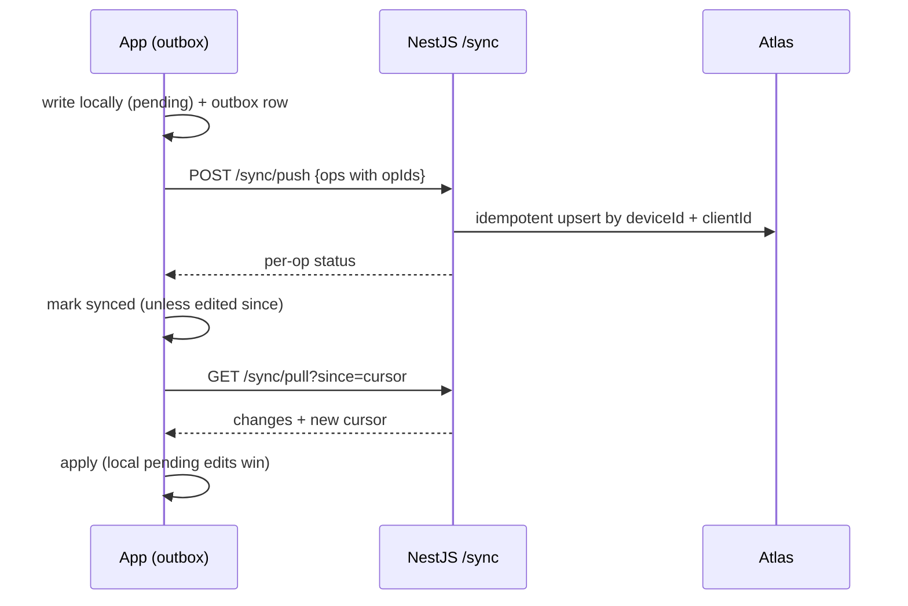
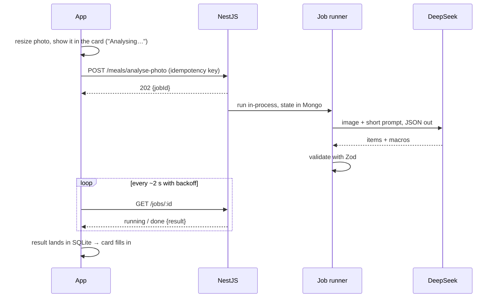
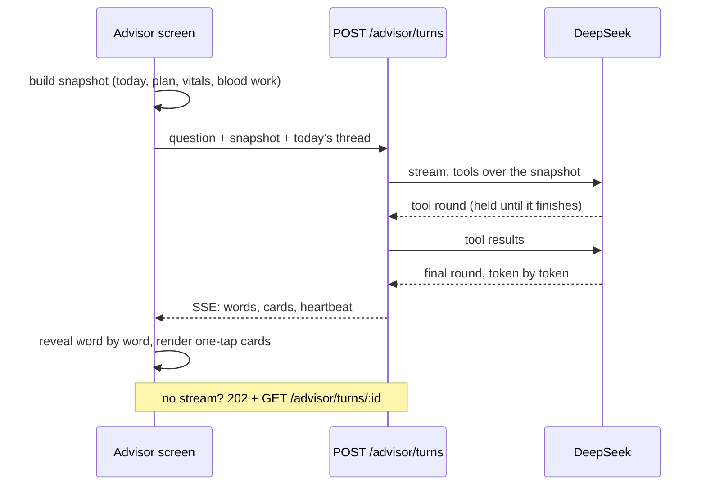
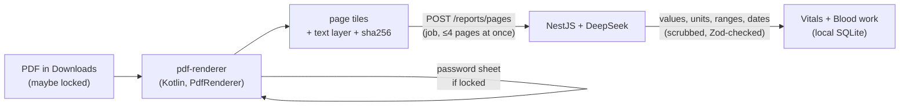

# Halo architecture

[← Back to the README](README.md)

## Phone ↔ backend

### Sync



### Jobs: meal photos and report pages



### Streaming: the Advisor



### Voice: the floating ring

```mermaid
sequenceDiagram
  participant Ring as Ring (overlay service, Kotlin)
  participant API as POST /voice/turns
  participant OAI as OpenAI
  participant AI as DeepSeek
  participant App as Halo (JS, when running)
  Ring->>Ring: tap → mic (foreground only while recording), stops on silence
  Ring->>API: WAV + the snapshot Halo last wrote + today's thread
  API->>OAI: speech to text (gpt-4o-mini-transcribe)
  API->>AI: the Advisor's tools over the snapshot + tools that log or open
  AI-->>API: actions + one short line (guarded; no claim without its action)
  API-->>Ring: line + actions + speech id
  Ring->>Ring: show the line, queue the logs, notify with Undo
  Ring->>API: GET /voice/speech/:id
  API->>OAI: text to speech (gpt-4o-mini-tts, PCM stream)
  API-->>Ring: audio as it's made → played with music ducked
  Ring-->>App: queue drained into SQLite + outbox (at once, or on next open)
```

The ring works while Halo's JS isn't running: Halo keeps a snapshot, the backend address and consent in the overlay's store, and the ring's logs wait in a queue. Halo keeps neither the audio nor a transcript on the server.

### PDFs: rendered on the phone



## Mobile architecture

- **Local-first:** SQLite (Drizzle) holds the logs, and MMKV holds small state (answers, plan, theme). Writes are optimistic and queue an outbox row.
- **Assistant engine** (`halo-shared`):
  - `signals` → `pa` vets and ranks what could be said, and picks one brief.
  - `moments` plans the day's notifications.
  - `learning` learns meal and wake times.
  - `loop` checks the outcome the next morning.
  - The AI only rewords a brief.
- **Missing data:** measured → inferred → assumed → hidden, with each value labelled by its source.
- **Local modules (Kotlin):** `pdf-renderer`, `speech` (on-device dictation), `screen-time` (sleep inference) and `overlay` (the floating ring: score, nudge pill, card, voice).
- **Theme:** nine photo-derived tier themes, light by default with a dark switch.

## Backend architecture

- **Modules:** `device`, `sync`, `meals`, `reports`, `jobs`, `insights`, `advisor`, `voice`, `ai`, `health`, `legal`.
- **`AiService`:** the only code that talks to DeepSeek. It adds a timeout, one retry, Zod-checked JSON and a template fallback, and calls use `reasoning_effort: 'none'`.
- **`OpenAiService`:** speech only, for voice from the ring: transcription and a calm text-to-speech voice. About $0.003 per voice log.
- **Auth:** a shared app key (`x-app-key`) for access, a per-install UUID (`x-device-id`) for identity. Rate limits and job caps apply per device.
- **Advisor guard:** drops internal scores, goal lists and promises of a card that doesn't exist.
- **Tests:** Vitest unit tests and 66 end-to-end tests (in-memory Mongo, fake AI and speech).

## Edge cases handled

- **Offline:** every screen works. Meal photos wait as pending cards and are analysed once the phone is back online.
- **AI failure:** a template is always on screen first. Meals can be retried, re-analysed with a note, or entered by hand.
- **Missing Health Connect data:** never shown as 0. Rows say Estimated or "No data".
- **Reports:** locked PDFs, scans, more than 12 pages, mixed units, values like "<0.5", several dates in one report, the same report added twice. Names and IDs are scrubbed.
- **Time:** the day runs past midnight, and clock format follows the phone.
- **Safety:** red-flag questions get emergency numbers, and nothing is diagnostic.
- **Voice:** offline or on a call the ring says so without recording; Do Not Disturb keeps the reply silent; silence is caught on the phone and on the server; a reply never says something was logged unless it was, and every log has Undo on its notification.
- **Abuse:** rate limits, job caps, daily page limits, request size limits.

## Run it yourself

**Prerequisites:**
- Node 24
- JDK 17
- the Android SDK (`ANDROID_HOME`)
- Docker, for a local Mongo
- an Android phone over USB

```bash
# backend
cd halo-backend && cp .env.example .env   # MONGODB_URI, APP_KEY (16 chars), DEEPSEEK_API_KEY, OPENAI_API_KEY (voice)
docker run -d --name halo-mongo -p 127.0.0.1:27017:27017 mongo:8
npm install && npm run start:dev
adb reverse tcp:3000 tcp:3000

# app (dev client)
cd halo-app && cp .env.example .env       # EXPO_PUBLIC_APP_KEY = the backend's APP_KEY
npm install
npx expo run:android --device             # builds and installs the dev client
adb reverse tcp:8081 tcp:8081 && npx expo start --dev-client
```

Shared logic: edit `halo-shared/src`, then run `npm --prefix halo-shared run sync` and `npm --prefix halo-shared test`.

### Build the release APK

```bash
cd halo-app
# .env.production.local (gitignored):
#   EXPO_PUBLIC_API_URL=https://<your-heroku-app>.herokuapp.com
#   EXPO_PUBLIC_APP_KEY=<same 16-char key>
npx expo prebuild --clean -p android
cd android && NODE_ENV=production ./gradlew assembleRelease
# → android/app/build/outputs/apk/release/app-release.apk
```
